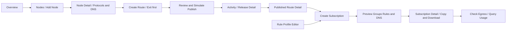

# Meshstrata 前端页面与交互设计

**版本：v1.0｜2026-11-10｜阶段：可交互前端原型**

依据 [产品设计 v1.0](Meshstrata_产品设计_v1.0.md)，将节点接入、线路发布、客户端配置和故障处理组织为可连续操作的页面。按用户授权优化导航与交互；产品中的协议、出口、身份、DNS、发布与撤销边界保持一致。UI 提供英文/简体中文，无明确保存偏好时跟随浏览器，本文使用中文。

本阶段实现布局、URL 路由、表单、前端校验、关联跳转及明确标记的模拟状态变化。使用本地演示数据，不接业务接口，不执行安装、探测、真实发布、撤销或本地 Mihomo 操作。完整 YAML 仅作带演示标记的预览，不承诺可用于生产。开发任务与文件归属见 [前端实施任务](Meshstrata_前端实施任务_v1.0.md)。

## 1. 信息架构与主要决策

围绕“准备节点 → 建立线路 → 给设备生成配置 → 按需排障”组织导航。一级导航不等同于数据库对象列表。

| 入口 | 承载内容 | 交互理由 |
| --- | --- | --- |
| `Overview` | 数量摘要、待处理事项、最近操作、快捷创建 | 首页帮助选择下一步；不伪造实时监控大屏。 |
| `Nodes` | 节点列表、接入向导、单节点协议/端口、DNS、隧道和资源 | 先找到节点，再管理它拥有的资源。 |
| `Routes` | 线路列表、创建向导、详情、编辑、测量和出口策略 | 路径、逐跳协议与末端出口放在同一上下文。 |
| `Client Config` | `Subscriptions`、`Rule Profiles` 两个二级入口；域名集合位于规则编辑器 | 订阅用于交付设备，规则用于解释交付内容；减少一级菜单。 |
| `Activity` | 操作记录、发布/回滚/撤销/清理任务详情 | 从失败或待处理状态直接到可解释的任务。 |
| 侧栏底部 `Settings` | 平台默认值、证书、位置服务、Relay、本地集成、日志、管理员 | 低频全局设置与日常操作分开。 |

`Egress Routing`、`Measurements`、`Listeners`、`Service Domain Sets` 不增加一级导航。登录使用独立页面；本阶段默认直接进入原型，演示登录不构成真正的认证保护。

原文 `Dashboard` 对应 `Overview`；`Rule Profiles` 和 `Subscriptions` 均保留完整功能，只调整归属。原文协议候选与测量章节落实在线路向导和详情；配置发布落实为统一任务详情；日志策略在 Settings，按需日志查看在 Activity。

### 1.1 页面路由

采用 Vue Router 的 hash history，逻辑路径如下，实际 URL 为 `/#/…`。现有 Go 静态服务器无须增加 SPA fallback。路径使用稳定 ID；显示名和语言改变不改变 URL。

| 逻辑路径 | 页面/状态 | 主要入口与去向 |
| --- | --- | --- |
| `/` | 重定向 Overview | 不产生重复首页。 |
| `/overview` | 总览 | 节点、线路、订阅、任务的精确入口。 |
| `/nodes` | 节点列表 | 添加、详情、带节点筛选的线路。 |
| `/nodes/new?step=basics` | 节点接入向导 | `basics/install/verify`；成功到节点详情。 |
| `/nodes/:nodeId?tab=overview` | 节点详情 | `overview/protocols/dns/connectivity/routes`。 |
| `/routes` | 线路列表 | 创建、详情、复制为草稿。 |
| `/routes/new?step=exit` | 创建线路 | `exit/paths/options/review`；接受 `exitNodeId`。 |
| `/routes/:routeId` | 线路详情 | `overview/measurements/resources/history` 标签。 |
| `/routes/:routeId/edit?step=options` | 编辑线路草稿 | 复用向导；保留已发布版本。 |
| `/client-config` | 重定向订阅列表 | 二级导航默认选 Subscriptions。 |
| `/client-config/subscriptions` | 订阅列表 | 新建、详情、到期和同步状态筛选。 |
| `/client-config/subscriptions/new?step=basics` | 新建订阅 | `basics/routes/policy/review`；接受 `routeIds`、`profileId`。 |
| `/client-config/subscriptions/:subscriptionId` | 订阅详情 | `overview/entries/config/usage` 标签。 |
| `/client-config/subscriptions/:subscriptionId/edit` | 编辑订阅 | 编辑规则/分组/线路；有效期另有专用操作。 |
| `/client-config/rule-profiles` | 规则方案列表 | 新建、编辑、复制、预览及引用订阅。 |
| `/client-config/rule-profiles/new` | 新建规则方案 | 保存后进入编辑页或返回订阅草稿。 |
| `/client-config/rule-profiles/:profileId/edit` | 规则编辑器 | 原文、解析规则、DNS 映射、域名集合、引用检查。 |
| `/activity` | 操作记录 | URL 筛选 `kind/entityType/entityId/status`。 |
| `/activity/releases/:releaseId` | 任务详情 | 发布/回滚/撤销/清理；回到来源对象。 |
| `/settings?section=general` | 系统设置 | `general/ports/relay/location/certificates/client/logs/admin`。 |
| `/login` | 单管理员演示登录 | 内部 `returnTo`；原型可直接进入。 |
| 其他路径或不存在的对象 ID | 未找到/对象不存在 | 返回所属列表；不静默显示另一对象。 |

侧栏同时高亮所属一级入口和二级入口。详情标签、向导步骤、搜索、筛选、排序、分页写入 URL；抽屉用受控 query，如 `panel=egress`、`panel=check-egress`、`panel=preview`。参数必须经过白名单解析。含凭据、secret、token 的值不得进入 URL。

### 1.2 主要操作流



保存草稿不等于发布。查看候选、重测、切换详情标签或调整筛选不改动已发布线路。节点、线路、规则、订阅都显示关联对象的可点击名称，避免记住 ID 再手工搜索。

## 2. 通用布局与操作约定

### 2.1 布局

沿用现有浅色、低饱和绿色控制台风格与 Naive UI。桌面左侧约 224px 导航，顶部面包屑、演示标记和管理员菜单；内容区左对齐，常规页最大宽约 1440px，复杂表格可扩展。表单最大宽约 880px，创建向导采用主内容加约 300px 摘要栏。间距以 8px 为基础，正文至少 14px；状态不得只靠颜色。

页面头只放一个主要操作，次要操作放并列轻按钮或更多菜单。列表采用“标题和新增 → 搜索/筛选 → 表格 → 分页”，详情采用“名称和状态 → 关键摘要 → 标签内容”。不在每个页面堆满指标卡。地址、端口、版本和配置文本使用等宽字体。

窄屏将侧栏收进抽屉，摘要栏移到表单之后；表格只在自身容器横向滚动，关键名称和操作保持可达。触控目标约 44px；表单明确 label，错误与字段关联；键盘可到达操作、重排按钮和弹窗，关闭后焦点返回触发点。路径图同时提供文字顺序，不依赖画布才能编辑。

### 2.2 状态与反馈

| 场景 | 必须呈现的行为 |
| --- | --- |
| 数据加载 | 骨架或局部 loading；已有快照继续显示，不整页闪白。 |
| 从未查询 | `Not Queried` 和明确的查询按钮；不显示 0 或 Online。 |
| 过期快照 | 保留数值、`Last Queried`、`Stale`，允许手动刷新。 |
| 查询失败 | 当前错误与上次成功结果分开；保留输入及重试入口。 |
| 无对象 | 解释如何开始，并给创建按钮。 |
| 筛选无结果 | 显示清除筛选；不误导用户创建新对象。 |
| 能力未核实 | `Not Checked` / `Not Supported` / `Incomplete`，附原因。 |
| 保存 | 内联提示或 toast；保持上下文。一次点击只产生一次提交。 |
| 长操作 | 创建任务并进入任务详情；显示逐阶段结果和失败定位。 |
| 禁用操作 | 附原因及可去往的修复入口，不仅灰掉按钮。 |

单个对象分开呈现配置状态、连接状态、最近检测结果。没有连续采样时不使用 `Live`、实时速率图或 24 小时历史图。页面显示全局 `Prototype · Demo data`，模拟操作按钮或结果明确带 `Simulate` / `Simulated`。

只在点击时推进模拟任务；允许有限、可取消的演示延时，不循环计时或后台轮询。关闭测量/检查抽屉和离开页面时取消该次界面任务。离开发布详情只停止界面更新，不应把“离开页面”设计成撤销真实发布。

### 2.3 返回、草稿和确认

列表进入详情后返回，恢复原筛选、页码和滚动位置。创建向导保留已填写内容，返回前一步不清空后续草稿；修改上游条件时标记失效的候选、端口和验证结果，并解释需要重选的部分。

未保存编辑离开时提供 `Save Draft`、`Discard`、`Stay`。草稿按对象/草稿 ID 隔离，刷新可恢复；敏感输入只留内存。从订阅草稿跳到新建规则方案，保存后带 `profileId` 返回原草稿；`returnTo` 仅接受已知站内路径。

普通保存、筛选、打开详情不弹确认。节点移除、订阅删除/重置 token、共享资源修改和立即重连等操作显示一次影响确认，列出对象、后果、离线待同步部分。发布前 Review 即确认界面，不再额外弹一个相同的“确定吗”。

## 3. 各页面功能与操作

### 3.1 Overview

上方显示登记节点、已发布线路、有效订阅三项可点击统计；下方优先列待处理事项，如草稿待发布、节点离线、到期待撤销、Rollback Pending 和 Pending Cleanup。最近操作列时间、对象、结果与任务链接。资源与用量为最近快照和时间，可选择范围后 `Refresh`。

无节点时引导 Add Node；有节点无线路时引导 Create Route；有线路无订阅时引导 Create Subscription。完成后不重复显示新手向导。查询范围在操作前可见，不把首页 Refresh 理解为全网扫描。Controller 构建信息保留为低优先级卡片或设置中的系统信息。

### 3.2 Nodes 列表与接入

列表主列：名称/位置、接入方式、接入地址、连接摘要、关联线路数、最近确认；Agent/Mihomo 版本可作次级列。搜索名称/IP，筛选 Direct/Reverse、位置、网络监管级别、状态。点击名称进入详情，线路数进入 `/routes?nodeId=…`。按需批量 Update Location/Query Status 要先选择节点并显示结果汇总。

接入向导为三步：

1. **Basics**：名称、Connection Mode。Direct 必填代理接入地址；Reverse 不填公网入站地址，展示只读的固定 Relay 与条件检查。未配置 both/Relay 时给 Settings 的修复链接并保存当前草稿。
2. **Install**：展示 Controller 地址、信任指纹、一次性 token 的有效期和安装步骤，复制按钮逐项反馈。原型只展示不可执行的示例，不把安装脚本自动运行到本机。重新生成演示 token 时让旧示例失效。
3. **Verify**：注册、身份、版本、位置逐项展示。`Simulate Registration` 演示成功/失败/过期；可重试失败项。完成后进入详情的 protocols 标签，提示下一步配置协议。

Control 来源 IP、Direct 代理接入地址、Observed Egress IP 使用不同字段和说明。自动位置更新不覆盖手填国家/城市/标签。

### 3.3 Node Detail

页头为名称、位置、连接模式和 Query Status；Edit、Update Location、Remove 放次要操作。Reverse 的 Control Connection、Tunnel Connection、Route Verification 三项分别显示状态和时间。

| 标签 | 排布与操作 |
| --- | --- |
| Overview | 地址、版本、Last Confirmed、资源快照、已应用配置版本；CPU/内存/磁盘与网速按需查询，网速不称为带宽上限。 |
| Protocols & Ports | 上区逐协议默认值，下区实际 Listener 表；避免把 Preferred Port 当实际监听端口。协议高级参数按类型展开。 |
| Target DNS | 实例级上游、出站与启动解析；右侧列受影响线路。修改经 Review/Release，不在某条线路内偷偷保存独立 DNS。 |
| Connectivity | Direct 显示浏览器 HTTPS 探测端点配置；Reverse 显示固定 Relay、TCP+mTLS、远端回环 Listener、Relay 回环映射和修订。 |
| Routes | 本节点作为入口/中转/出口的线路，可筛选并跳详情；Create Route with This Exit 预填出口。 |

Protocols & Ports 的每行包含 Enabled、Listen Address、Preferred Port（固定/自动）、Additional Port Pool、传输能力与业务 TCP/UDP 能力。启用或禁用协议只控制新资源分配，不能等价为关闭 Listener。实际 Listener 显示名称、地址、端口、TCP/UDP、下一跳、引用数和发布状态；编辑前列依赖，固定端口冲突显示 `PORT_IN_USE`，不静默换端口。

Reverse 内部段锁定 SS 2022 TCP，Local Listener Port 与 Relay Mapping Port 分列且仅回环；管理机作为入口仍允许四种首版协议。Target DNS 与 HTTPS 探测配置变更分别标记其相关缓存过期。

Remove 打开影响确认：受影响线路/订阅、管理身份撤销、反向隧道撤销和待清理资源。模拟确认后保留关联记录和 Pending Cleanup，不删除引用使问题消失，也不自动替换节点。

### 3.4 Routes 列表与详情

列表主列：名称、固定路径缩略、末端/自定义出口摘要、配置状态、业务能力、最近验证和引用订阅数。筛选出口、节点、协议、状态和 UDP 能力。主按钮 Create Route；行操作 View、Edit、Duplicate as Draft。复制创建新 ID，不继承“已验证/已发布”结果。

详情上方用可点击节点块显示固定路径，每段标协议与实际端口，区分入口端口和内部端口。右侧摘要显示已发布修订、草稿变更、出口策略及最近检测时间。操作：Edit、Add to Subscription、Measure、Check Egress；资源清理等低频操作进更多菜单。

Overview 展示路径和业务能力；Measurements 展示分段测量、来源、方法、时间与缓存有效期；Resources 展示 Listener/隧道/端口引用；History 链接 Activity 的发布记录。失败检测只更新检测结果，不改发布版本或自动换路。

已发布版本与当前编辑草稿可以并列比较。点击 Add to Subscription 可选择已有订阅，或带 `routeIds` 新建；未发布/缺少可用版本时解释原因并给发布入口。撤下线路/删除草稿须先核对订阅和资源引用，不能让订阅留下无解释的缺项。

### 3.5 Create Route 与 Edit Route

四步向导，底部固定 Back、Save Draft、Next/Simulate Publish。右侧始终展示出口、客户端监管级别、路径、UDP、出口策略和待处理问题摘要。

| 步骤 | 内容 | 前进条件 |
| --- | --- | --- |
| 1. Exit Node | 先选最终出口。默认继承 Settings 的强监管/弱监管与 UDP 偏好，在默认折叠的 Recommendation Preferences 中可单独覆盖；监管级别不是出口位置。 | 存在可用候选出口；Reverse 不允许 Require UDP Relay。 |
| 2. Choose Paths | Recommend Routes、3 条默认去重候选、调整数量、测量模式分区、展开协议组合、手工路径入口。 | 至少选中一个结构有效候选；不将测量缺失当零或自动最佳。 |
| 3. Route Options | 每条路径命名；默认折叠高级逐跳编辑；小按钮 Egress Routing；实际 Listener/端口分配预览。 | 名称不冲突，路径/协议/端口与出口策略的前端校验通过。 |
| 4. Review & Publish | 配置差异、受影响节点/订阅、待开放端口、能力与检查清单；显示模拟验证。 | 阻断问题已处理；明确显示哪些仅是模拟或 Not Checked。 |

客户端监管级别用于首跳协议建议和测量样本分组；强监管优先建议 VLESS/Trojan，弱监管优先建议 SS 2022。节点标签独立于客户端条件，不根据地理位置推断。修改草稿偏好不重写已经选择的 Listener 或已发布路径；旧草稿中的地区枚举兼容转换成新级别。

多选候选时第 3 步用可切换的路径草稿列表分别命名，每条显示错误数；最终创建批次任务，各线路单独报告结果。一个失败不冒充整批成功，不实现跨线路假原子事务。

候选分为 Network RTT、Browser Estimate、Partial Measurements。卡片逐段给值/方法/时间；Browser 模式使用 Browser HTTP Latency、Estimated Path Cost；HTTP Fetch Duration 与资源时序口径不混排。显示样本数、离散程度、Incomplete、Path Unverified。总值不包含未测外部代理或隧道。缺首段时只呈现可用的节点间成本，不出完整成本排名。

`Network Changed` 将首段缓存标记过期；`Measure Missing`、`Remeasure`、`Cancel` 为明确操作。浏览器不能原始测 TCP/UDP 的能力用说明和本地集成入口表达，原型不实际探测。实际协议认证状态另列，HTTP 成功不推导 Hysteria 2 可用。

Reverse 出口仅生成固定本地 Relay → 远端两节点路径；不能在高级编辑插入其他节点或把远端改成入口。管理机必经、内部 SS 2022 TCP、业务 UDP 拒绝均可见；真实隧道 RTT 未知时写 Not Measured。

前端校验通过后点击 Simulate Publish 创建任务并进入 Activity；成功后提供 View Route、Create Subscription。编辑已发布线路失败时保留旧版本；不会把草稿覆盖掉旧的可用配置。

### 3.6 Egress Routing 侧栏

从线路第 3 步或详情 Edit 进入；宽屏侧栏约 720px，窄屏全屏。顶部明确 `Applies on terminal node …`，默认 Node Default；启用 Custom 才显示 Targets、Rules、Unmatched Traffic 和只读 Target DNS 摘要。保存仅更新线路草稿，发布由线路 Review 完成。

Targets 支持 Node Default、Network Interface、Proxy Endpoint。网卡可以选已知名称或填写，状态未验证时明确标记；代理必须手动选 HTTP/SOCKS5，填写地址/端口/可选认证，不能按 7890 推断协议。localhost 与网卡均相对末端节点。代理认证只存内存演示值，不进客户端预览。

Rules 表支持增删、上下移动，拖拽可选但必须提供键盘替代；Destination 为 IP/CIDR，单 IP 规范化为 /32 或 /128。IPv6 仅在启用且验证的示例能力下开放。上到下首次命中，提示重叠/遮蔽，不自动改序。唯一末尾 MATCH 固定在底部，不允许拖走；Custom 默认未匹配 REJECT，可显式选择其他目标。

匹配目标失效时显示失败，不尝试后续规则或默认直连。HTTP 与未经验证的网卡/SOCKS5 不宣称业务 UDP；当前 Mihomo 自己的 TUN、自指代理或明显 Listener 回环阻止保存。`no-resolve` 属于高级显式选项。按 IP 分流时提示 DNS/业务最终公网出口不一定相同。

共享策略必须显式选择，展示引用线路与修订；编辑提供“另存新策略用于本线路”（默认）和“更新所有引用线路”两个选择，后者统一影响确认和发布。不能在同一组里混用策略修订。

### 3.7 Check Egress 共用侧栏

线路详情、订阅配置预览都可打开。先选择本次线路/订阅条目/出口组、策略修订，再选择检查项。每条结果标明 scope、测试地址、时间、Observed/Failed/Not Supported/Not Checked。

| 检查项 | 输入与输出 |
| --- | --- |
| Test Destination | 业务地址 → 连通性、Rule Resolution IP、命中规则、所选出口、可观察连接信息；没有 IP 回显则公网 IP 为 Not Checked。 |
| Check Egress IP | HTTPS 回显服务 → 该服务观察到的 IP、路径与命中出口，不套用于其他业务目标。 |
| Check DNS Path | 服务域名/组 → 可观察的解析器路径及覆盖范围，不以解析器国家判断泄漏。 |
| Client Coverage | IPv6/UDP/WebRTC 检查范围；无法检查的项保持 Not Supported/Not Checked。 |

逐出口目标直接检查时醒目标 `Target-only Check`，说明绕过业务规则。超时、DNS、TLS 和 HTTP Access Denied 使用不同错误说明。配置或目标变化后旧结果标记 Stale。

已配对的本地 Mihomo 才呈现 Apply to New Connections 与独立的 Reconnect Now；后者先显示影响连接范围。未配对时给 Settings > Local Client 链接及人工检查说明。原型只模拟，不调用本机地址、清连接或 DNS 缓存。

### 3.8 Client Config 与 Subscriptions

Client Config 顶部二级导航：Subscriptions、Rule Profiles。订阅列表展示名称、有效期/剩余时间、线路数、规则方案、链接/入口同步状态、最近用量及查询时间；用量未知显示 Not Queried。主按钮 Create Subscription。

新建四步：Basics（名称/说明/有效期，禁止过去时间）→ Routes（选择并排序已发布线路、显示出口与能力）→ Policy（一套规则方案、两个默认启用的分组选项、每组初始成员、客户端网络模式）→ Review（条目/端口分配、组、规则、DNS、校验和生成）。从线路进入时预选，仍需确认有效期和规则。

规则选择器旁可预览或 Create Rule Profile，后者保存订阅草稿后跳编辑器再返回。选择方案不偷偷改变线路。All Routes Group 与 Group by Exit Node 独立开关；自定义策略分开组，同策略修订一致。每个组都是手动 select，成员顺序来自线路选择，可设初始成员；空组、失效引用、缺失目标、重复名阻止生成。

Review 展示 `subscription × route` 独立条目 ID、实际入口协议/地址/端口、凭据“将生成”的摘要。Hysteria 2 与普通 SS 2022 入口展示隔离分配，端口不足/固定冲突定位到对应节点，不承诺共享。Reverse 只显示管理机公网入口；客户端输出不包含远端回环、映射端口、管理或隧道凭据。

默认完整配置 TUN + fake-IP、IPv4 目标、业务 UDP 显式拒绝；System Proxy 标 Limited Coverage；IPv6 与业务 UDP 必须显式能力检查。页面不承诺 YAML 自动实现防火墙或 kill switch。

订阅详情四个标签：Overview（有效期、分组、规则、URL 操作）、Entries（逐条目身份/入口/状态/清理）、Config（proxies/groups/rules/DNS 分区预览及完整文本）、Usage（按需查询）。Copy URL、Download Config、Preview Config 主次有别，演示 URL 使用 example.invalid；复制失败提供选中文本替代。

| 操作 | 操作逻辑 |
| --- | --- |
| Change Rule Profile / Edit Grouping | 打开局部编辑，预览差异并保存；下次订阅更新取得内容，不重置代理身份或改变路径。 |
| Extend Expiry | 选择新到期时间并检查晚于当前时间；显示受影响条目与待同步节点。 |
| Reset Token | 确认旧下载地址失效；仅换下载 token，不轮换入口凭据。 |
| Delete Subscription | 确认链接失效和入口身份撤销；离线时显示 Link Revoked; Node Sync Pending，资源确认后才回收。 |
| Query Usage | 对相关入口按需查询，逐条目展示口径与覆盖期；不叠加中转/隧道流量。 |
| Preview / Download | Full Config 与 Proxy Provider 明确分开；provider 只含 proxies，不能混称完整配置。 |

Usage 分别支持累计字节、连接建立次数、当前连接快照、Unavailable。总体数据仅对同口径同覆盖范围可加的条目求和，其他标部分覆盖；不把快照字节冒充历史用量，不把会话次数叫 HTTP 请求数。

### 3.9 Rule Profiles 编辑器

列表为名称、说明、更新时间、引用订阅数，提供 New、Edit、Duplicate、Preview、Delete。被引用方案不能直接删除，先列订阅并提供替换方案入口；复制得到新 ID。

编辑器上方名称/说明，中间左侧英文规则文本，右侧可插入的线路/组目标；下方标签 Parsed Rules、DNS Mapping、Service Domain Sets、Validation。支持粘贴规则行或完整 rules 段，保留原有顺序；本阶段仅支持明确的规则片段，不假称通用 Mihomo 编译器。

一个 MATCH 提取为兜底选择，最终置于末尾；多个 MATCH 标记所有行并要求选择，禁止静默保留第一个。输出默认在用户规则前放业务 UDP REJECT，最终恰好一条 MATCH。错误定位到行、列/目标，并能回到文本。

预览可选择订阅上下文；没有上下文时显示“引用存在不代表此订阅会生成该组”。域名规则与纯域名 RULE-SET 可以预览域名 → DNS 出口映射；进程/IP/端口类给 DNS egress cannot be inferred from this rule。重叠域名/集合提出冲突，不自动选择国家或改业务规则。

Service Domain Sets 作为编辑器内管理面板：稳定标识、纯域名成员、目标组、引用方案，支持新增、编辑、依赖检查删除。示例 Google/AI 仅是演示集合，不宣称覆盖所有服务域名。规则方案保存提示“下次订阅更新生效”，不触发服务器发布或重测。

### 3.10 Activity 与任务详情

Activity 提供 Events、Releases、Node Logs 三个视图（query `view`），共享时间/对象/结果筛选。仅展示节点加入移除、配置变更、撤销、手动检测、错误；不做逐请求浏览历史。Node Logs 先选节点、组件和尾部行数/字节上限，点击 Load 后展示截取内容，默认不拉全文或自动跟随。

任务详情显示动作、来源对象、期望修订、起止时间、阶段、逐节点结果和下一步。常规顺序为保存草稿 → 参数/语法/依赖 → 后续节点应用 → 入口应用 → 实际 Listener/认证检查 → 完整线路验证 → 确认发布；API Applied 与 Applied & Verified 分列。

Reverse 任务增加远端 Listener、Relay 授权、隧道与映射建立、映射认证转发、入口应用的依赖步骤。回滚显示平台配置恢复结果，不声称恢复外部代理或网卡。失败面板指向失败节点/资源/字段；Retry 只重试允许阶段，不重复减少引用。

显示成功、失败、Rollback Pending、Rollback Failed、Pending Cleanup 和 Node Sync Pending 场景。节点离线不能标记已确认；引用归零仍等实际移除确认再释放端口。只有允许的预应用阶段可取消任务；已应用后的动作应称回滚，不能用 Cancel 掩盖恢复过程。

### 3.11 Settings 与登录

设置使用左侧分组/窄屏选择器，右侧只显示当前组。每组独立 Save/Discard 和字段错误，不把多个设置页未保存值混在一个大提交内。

| 设置组 | 内容与默认值 |
| --- | --- |
| General | 环境偏好、UDP 传输与业务 UDP 分开；测量成功缓存 96h、失败 5min；界面语言/日期格式；系统构建信息。 |
| Ports | 系统新资源端口池 20000–29999、Web 8443、管理 9443 的计划说明；不允许保存动作直接改当前实际服务。 |
| Local Relay | 部署角色与本地注册节点摘要；只有 both + 本地 Agent 条件满足才配置隧道端点及回环映射池，Relay 节点不可任意选择。 |
| Location | IP 地理 API 服务商、密钥状态、查询演示、手工覆盖策略；密钥输入不回显或写浏览器存储。 |
| Certificates | 域名、DNS 服务商、受限 API 凭据、DNS-01/导入证书选择、证书状态；管理 CA、TLS、REALITY、隧道凭据用途分开。轮换先展示关联对象。 |
| Local Client | 本地 Mihomo 配对地址（默认回环）、secret、来源限制说明、配对/解除配对演示与本地 RTT 辅助能力；secret 仅内存。 |
| Logs | warning/error，单文件 5MiB，最多 4 份含当前，总 20MiB，最长 7 天；debug 必填时长，到期恢复的演示状态。 |
| Admin | 单管理员密码修改表单、退出；不增加用户/角色/团队系统。 |

登录有账号、密码、显示密码、提交错误状态；允许内部安全 returnTo。原型通过 Enter Demo 进入，不收集真实密码，不把浏览器路由 guard 当安全认证。真实首次初始化和服务端会话留到接口阶段。

## 4. 前端共享约定

### 4.1 代码组织

保留 Vue 3、TypeScript、Naive UI、Vue I18n、Vite 与 Go embed 构建位置。增加固定版本 Vue Router；不引入第二套 UI 框架或重型全局状态库。基础设施完成后各业务会话只写自己的 feature 目录，统一路由和共享模型由基础设施/集成任务维护。

```text
controller/web/src/
  app/                   # Router, navigation, providers, layout
  components/            # Shared page, status, state, confirmation and summary UI
  domain/                # Entities, enums, references, reusable pure checks
  demo/                  # Seeds, reactive workspace, persistence, scenario runner
  composables/           # Draft, dirty guard, query state, formatting, cancellable task
  features/
    overview/
    nodes/               # List and enrollment
    node-detail/
    routes/              # List and detail
    route-editor/
    egress/              # Egress editor and inspection drawers
    subscriptions/
    rule-profiles/
    activity/
    settings/
    auth/
  locales/               # Common resources; each feature owns locales/{en,zh-CN}.ts
```

公共组件至少包括 PageHeader、StatusBadge、QueryStamp、EmptyState、ErrorState、EntityLink、ConfirmImpactDialog、RoutePath、ValidationSummary、DemoNotice 和可取消任务反馈。表格、表单、抽屉等优先组合 Naive UI，不为现有库重造通用包装层。功能未实现时使用明确的 FeaturePlaceholder，不能伪装成正常空数据。

所有显示文本通过 i18n，含校验、toast、空态、aria label、模拟错误。错误按稳定 code + params 表达，日期/数字用 locale 格式化；组名、ID、规则文本、用户命名不翻译。每 feature 独立的 en / zh-CN 资源由基础设施集中装载。Settings 的界面语言选择即时保存，刷新和 Reset Demo 后保留；Naive UI、页面标题、HTML lang 与日期/数字同步，中文变体归一为简体中文，不支持的语言回退英文。资源键与插值应匹配，不以英文回退掩盖中文缺项。

### 4.2 演示数据与状态

共享 workspace 是单一事实来源：页面从相同实体和关联 ID 读写；列表数值、关联详情、任务历史不能各自硬编码一份。以 Vue reactive/composable 暴露读模型和显式命令，持久化仅保存带 schemaVersion 的非敏感演示配置与草稿；浏览器存储损坏时给 Reset Demo 提示，不覆盖真实数据。

| 对象 | 最小表示与不能合并的状态 |
| --- | --- |
| Node / Listener | Direct/Reverse、地址类别、协议配置、实际端口、能力、引用；Control/Tunnel/Verification 分开。 |
| Route / Link | 固定节点顺序、逐段 Listener/协议、末端、草稿与已发布修订、策略 ID/修订。 |
| ReverseTunnel | 固定 Relay/远端、目标 Listener、回环映射、TCP TLS、修订、引用与两端确认。 |
| EgressTarget / Policy | 节点归属、类型/能力、有序 IP 规则、唯一 MATCH、修订；不存线路专属 Target DNS。 |
| Measurement / Check | 类型/方法/传输/时序口径、value 可空、样本、环境、时间/过期、scope、配置修订。 |
| RuleProfile / DomainSet | 有序规则、兜底、稳定集合标识、引用、修订；不以任意 YAML 文本替代所有结构模型。 |
| Subscription / Entry | 有效期、线路顺序、规则方案、分组、稳定 entry ID、入口端口、身份状态、撤销/同步状态。 |
| Release / Event | 类型、来源、阶段、逐节点 Applied/Verified/rollback、错误、时间、引用清理。 |
| UsageSnapshot / Settings | 口径、覆盖期、重置标记、查询时间；系统默认值与节点覆盖分开。 |

至少准备本地 both Relay、HK/SG/JP Direct、一个 Reverse 与一个离线节点；单节点、多跳、反向、Custom Egress、草稿与失败线路；有效/将到期/已过期/待同步订阅；Default/Work 规则。相互引用使用固定 ID，IP/域名使用文档示例或 example.invalid，无真实 token。

公共 Demo Controls 放在次级位置，可选择 normal/empty/error/stale/offline/partial、重置数据。场景选择只影响演示 workspace，不发请求。API 设计阶段替换显式命令的数据实现，页面保留相同的字段、校验定位和任务状态；当前不创建占位业务 HTTP API。

### 4.3 发布与编辑状态

前端将发布状态与资源清理状态分开建模。主要路径为 `draft → validating → applying → verifying → published`；失败可进入 `failed → rolling_back → rolled_back / rollback_pending / rollback_failed`。撤销和回收另按链接已撤销、节点待同步、资源待确认显示，不能以一个布尔 online 代替。

模拟状态迁移必须支持失败、重试和过期结果。修改草稿内容后使该草稿旧验证失效；最后已发布修订保持不变。能力未知默认不放行需要已验证能力的选项；不能把示例 UI 校验当真实协议或监听检查。

## 5. 验收路径

| 操作链 | 原型应能确认的结果 |
| --- | --- |
| 新建 Direct 节点 → 协议 → Create Route | 名称/模式/地址校验、端口展示、出口预填、返回关系正确。 |
| Reverse 节点 → 候选 → 发布结果 | 固定 Relay 两节点、无业务 UDP、独立连接状态、真实隧道缺测语义。 |
| 创建多条候选 → 命名 → 模拟发布 | 每条有独立草稿和结果；失败不覆盖其他线路或已发布版本。 |
| Custom Egress → 重排 IP 规则 → Review | 唯一末尾 MATCH、默认 REJECT、依赖与修订、DNS 范围说明正确。 |
| 线路 → 订阅草稿 → 新建规则 → 返回 | 原草稿保留且选中新规则，不重置线路或用户输入。 |
| 规则出现缺失组/多个 MATCH → 订阅预览 | 行级错误阻止生成，明确如何补选或修改。 |
| 订阅分组 → 配置预览/下载 | 组仅来自本订阅，策略修订分开，唯一 MATCH，provider 与完整配置分开。 |
| 删除订阅且入口离线 → Activity | 链接已撤销、节点待同步、引用未确认不能提前回收。 |
| 查询用量/测量/出口 → 离开 | 一次按需操作，带方法/时间/范围；无后台轮询、无真实网络探测。 |
| 直接打开/刷新详情 URL、浏览器返回 | 正确页面与 tab，保留列表条件；无效 ID 显示对应未找到。 |
| 键盘/窄屏、加载/空/失败/过期 | 可操作、可恢复、错误清晰、无页面级横向溢出。 |

每个业务会话运行类型检查和前端生产构建，并对自己负责的交互进行可用的浏览器检查。只为复杂纯逻辑增加有价值的测试（规则校验、分组、状态变更、端口/依赖约束），不为静态排版堆测试。报告实际完成的检查；无法运行浏览器时说明范围，不将构建成功称为交互验收通过。
